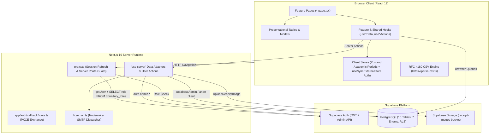
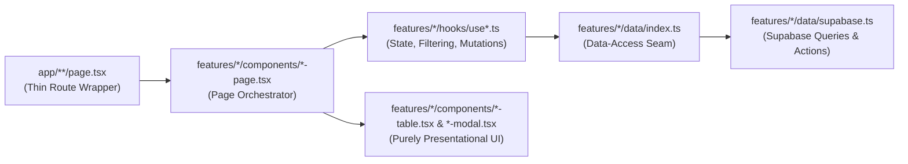
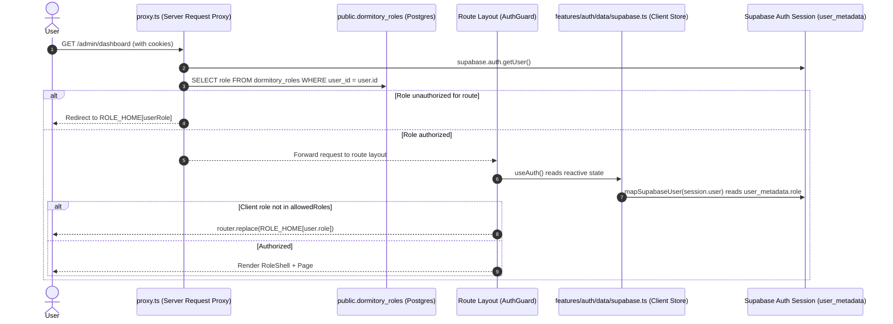

# DormPay v2 — Architecture

This document describes the application architecture, component communication, structural boundaries, and data/authentication flows in **DormPay v2 (`everest-v2`)**.

---

## 1. High-Level Architecture

DormPay v2 is a full-stack **Next.js 16 (App Router)** application communicating with a **Supabase** backend (PostgreSQL, Auth, Storage) and an **SMTP email transport** (`nodemailer`). [Sources: `package.json#L12-L35`, `lib/supabase/client.ts#L1-L15`, `lib/supabase/admin.ts#L1-L20`, `lib/email.ts#L1-L60`]

---

## 2. Core Architectural Boundaries

### 2.1 Vertical Feature Slices (`features/<feature>/`)
Domain code is organized into **13 feature modules** under `features/`:
`academic-periods`, `accounts`, `advisers`, `auth`, `clearance`, `dashboard`, `dormers`, `dormitories`, `events`, `expenses`, `fines`, `payments`, and `regular-charges`. [Sources: `features/`, `package.json#L2`]

Within each feature slice (with the single exception of `accounts`, which uses Server Actions directly in `features/accounts/actions/user-actions.ts`), responsibilities follow a four-tier vertical boundary:

1. **Route Wrappers (`app/**/page.tsx`)**: Thin 5–15 line files awaiting dynamic Next.js 16 `params` and rendering feature pages. [Sources: `app/(admin)/admin/dormers/page.tsx#L1-L10`, `app/(admin)/admin/events/[id]/page.tsx#L1-L15`].
2. **Page Orchestrators (`features/<name>/components/*-page.tsx`)**: Compose feature hooks with shared UI components (`PageHeader`, `StatCard`, `TableToolbar`, `TableFooter`) and manage modal visibility. [Sources: `features/dormers/components/admin/admin-dormers-page.tsx#L1-L150`, `features/payments/components/admin/admin-payments-page.tsx#L1-L120`].
3. **Presentational Components (`*-table.tsx`, `*-modal.tsx`)**: Receive all data and mutation callbacks strictly through props. They never import `@supabase/supabase-js` or feature data modules directly. [Sources: `features/dormers/components/admin/dormers-table.tsx#L1-L115`, `features/fines/components/admin/fines-table.tsx#L1-L120`].
4. **The Data-Access Seam (`features/<name>/data/index.ts`)**: Re-exports `data/supabase.ts` as `<feature>Data` alongside TypeScript contracts from `data/types.ts`. [Sources: `features/payments/data/index.ts#L1-L15`, `features/dormers/data/index.ts#L1-L15`].

### 2.2 Client vs. Server Execution in `data/supabase.ts`
The repository divides feature data adapters between Next.js Server Actions and browser execution:

| Execution Context | Feature Modules | Supabase Client Used | Verified Purpose / Capabilities |
| :--- | :--- | :--- | :--- |
| **Server Actions (`"use server"` at top of file)** | `advisers`, `dashboard`, `dormers`, `expenses`, `payments`, `regular-charges` (plus `accounts/actions/user-actions.ts`) | `createClient()` from [`lib/supabase/client.ts`](../../lib/supabase/client.ts) + `supabaseAdmin` from [`lib/supabase/admin.ts`](../../lib/supabase/admin.ts) | Executes on the Node.js server. Required for privileged calls (`supabaseAdmin.auth.admin.createUser`, `updateUserById`, banning accounts) and storage uploads (`receipt-images`). [Sources: `features/dormers/data/supabase.ts#L1-L35`, `features/advisers/data/supabase.ts#L1-L30`, `features/expenses/data/supabase.ts#L1-L40`, `features/accounts/actions/user-actions.ts#L1-L30`]. |
| **Browser Execution (No `"use server"` directive)** | `academic-periods`, `auth`, `clearance`, `dormitories`, `events`, `fines` | `createClient()` from [`lib/supabase/client.ts`](../../lib/supabase/client.ts) | Runs directly in the browser via `@supabase/ssr` `createBrowserClient`. [Sources: `features/academic-periods/data/supabase.ts#L1-L20`, `features/clearance/data/supabase.ts#L1-L25`, `features/events/data/supabase.ts#L1-L20`, `features/fines/data/supabase.ts#L1-L20`]. |

> [!NOTE]
> In the `"use server"` modules, standard database queries call `const supabase = createClient()` using [`lib/supabase/client.ts`](../../lib/supabase/client.ts) at module scope. Because `createBrowserClient` has no request cookies on the server, those queries execute under the `anon` database role, succeeding because public tables possess permissive policies (`CREATE POLICY "ALL" ... USING (true)`). [Sources: `features/payments/data/supabase.ts#L1-L25`, `supabase/migrations/20260804072843_remote_schema.sql#L473-L515`].

---

## 3. Authentication & Authorization Flow

Authentication and role enforcement operate across two complementary layers:

### Critical Role-Resolution Specifics
- **Server-Side Enforcement**: [`proxy.ts`](../../proxy.ts#L45-L95) reads the user's role from `public.dormitory_roles` (`select("role").eq("user_id", user.id).single()`) and redirects unauthorized users to `ROLE_HOME[userRole]`.
- **Client-Side Enforcement**: [`features/auth/data/supabase.ts`](../../features/auth/data/supabase.ts#L8-L22) reads the role from `user.user_metadata.role` (defaulting to `"dormer"` if null). This was implemented to bypass client-side query hangs when querying `dormitory_roles` directly. [Source: `features/auth/data/supabase.ts#L13`].
- **Synchronization Rule**: Because server and client read roles from different sources, creating or updating user roles must update **both** `public.dormitory_roles` and `auth.users.raw_user_meta_data` (`supabaseAdmin.auth.admin.createUser` / `updateUserById`). [Sources: `features/dormers/data/supabase.ts#L100-L160`, `features/accounts/actions/user-actions.ts#L20-L80`].

---

## 4. Global State & Cross-Feature Data Flow

DormPay relies on two global client stores:

1. **Client Auth Store ([`features/auth/data/supabase.ts`](../../features/auth/data/supabase.ts#L33-L93))**:
   - An external singleton store listening to `supabaseClient.auth.onAuthStateChange()`.
   - Exposed to React via `useSyncExternalStore` in [`useAuth()`](../../features/auth/hooks/useAuth.ts#L1-L15) with a 5-second safety timeout. [Source: `features/auth/data/supabase.ts#L58-L63`].
2. **Academic Period Store ([`features/academic-periods/store.ts`](../../features/academic-periods/store.ts#L1-L25))**:
   - A Zustand store (`useAcademicPeriodStore`) tracking the list of academic periods and the currently selected `currentPeriod`.
   - Consumed via [`useAcademicPeriods()`](../../features/academic-periods/hooks/useAcademicPeriods.ts#L1-L80) and mounted in the top bar of [`RoleShell`](../../features/dashboard/components/role-shell.tsx#L40-L70). Changing the period triggers re-renders and re-fetches across feature hooks.
3. **Dormitory Resolution Hook ([`lib/hooks/useDormitory.ts`](../../lib/hooks/useDormitory.ts#L1-L125))**:
   - Determines `dormitoryId`, `dormitoryName`, `enrollmentId`, and `roomNumber` by querying `dormitory_enrollment` (for `dormer`) or `dormitory_roles` (for staff).

---

## 5. Email & CSV Architecture

- **SMTP Email Dispatch**: Server Action [`sendEmail`](../../lib/email.ts#L1-L60) transmits HTML generated from templates in [`emails/`](../../emails/) via `nodemailer`, automatically CCing `dormpay@vsu.edu.ph`. [Source: `lib/email.ts#L34-L38`].
- **RFC 4180 CSV Engine**: [`lib/csv/parse-csv.ts`](../../lib/csv/parse-csv.ts#L1-L125) sniffs BOMs and decodes UTF-16LE, UTF-16BE, UTF-8, or Windows-1252 buffers before running an RFC 4180 parser. All CSV importers and exporters neutralize leading formula characters (`=`, `+`, `-`, `@`, `\t`, `\r`) using regex `/^[=+\-@\t\r]/`. [Sources: `features/dormers/lib/import-dormers-csv.ts#L18`, `features/payments/lib/export-payments-csv.ts#L12`].
