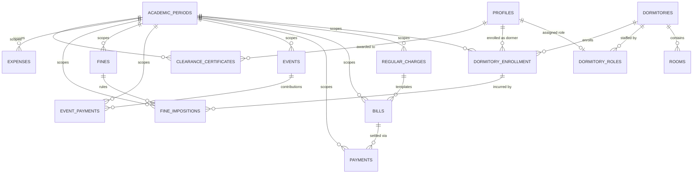

# DormPay v2 — Database Context

This document details the PostgreSQL schema, relationships, custom enums, functions, triggers, and Row Level Security (RLS) rules in **DormPay v2 (`everest-v2`)**.

All definitions are verified against the authoritative migration file: [`supabase/migrations/20260804072843_remote_schema.sql`](../../supabase/migrations/20260804072843_remote_schema.sql).

---

## 1. Environment Separation & Safety

- **Development Project**: `<dev-project-ref>` (used for local development, schema changes, and synthetic test data).
- **Production Project**: `<prod-project-ref>` (strictly off-limits for unapproved local development or automated migrations).
- **Safety Gate**: Before running `npx supabase db push`, check `supabase/.temp/project-ref` to verify it points to development (`<dev-project-ref>`).

---

## 2. Entity-Relationship Diagram

---

## 3. Custom PostgreSQL Enums (7 Enums)

All 7 enums are created in `public`:

| Enum Name | Allowed Values | Verified Source |
| :--- | :--- | :--- |
| `user_role_enum` | `'super_admin'`, `'adviser'`, `'treasurer'`, `'auditor'`, `'sa'`, `'dormer'` | `supabase/migrations/20260804072843_remote_schema.sql#L37-L44` |
| `semester_enum` | `'1st'`, `'2nd'`, `'Summer'` | `supabase/migrations/20260804072843_remote_schema.sql#L30-L34` |
| `enrollment_status_enum` | `'active'`, `'inactive'`, `'graduated'`, `'transferred'` | `supabase/migrations/20260804072843_remote_schema.sql#L10-L15` |
| `bill_status_enum` | `'Unpaid'`, `'Partial'`, `'Paid'` | `supabase/migrations/20260804072843_remote_schema.sql#L4-L8` |
| `event_status_enum` | `'Active'`, `'Completed'`, `'Cancelled'` | `supabase/migrations/20260804072843_remote_schema.sql#L17-L21` |
| `payment_status_enum` | `'Paid'`, `'Pending'`, `'Waived'` | `supabase/migrations/20260804072843_remote_schema.sql#L23-L28` |
| `fine_status_enum` | `'Unpaid'`, `'Paid'`, `'Waived'` | `supabase/migrations/20260804072843_remote_schema.sql#L2-L2` |

---

## 4. Tables Reference (15 Tables)

### Structural & Identity Tables
1. **`academic_periods`** [Source: `supabase/migrations/20260804072843_remote_schema.sql#L136-L152`]:
   - Columns: `id` (`uuid` PK), `academic_year` (`varchar(9)`), `semester` (`semester_enum`), `start_date` (`date`), `end_date` (`date`), `is_current` (`bool` default `false`), `is_deleted` (`bool` default `false`), `created_at`.
   - Constraints: `CHECK (end_date > start_date)`, `UNIQUE (academic_year, semester)`, and partial unique index `uix_one_current_period` (`WHERE is_current = true`).
2. **`dormitories`** [Source: `supabase/migrations/20260804072843_remote_schema.sql#L154-L168`]:
   - Columns: `id` (`uuid` PK), `name` (`varchar(100)` `UNIQUE`), `location` (`text`), `capacity` (`integer CHECK (capacity > 0)`), `is_deleted` (`bool` default `false`), `logo_url` (`text`), `created_at`, `updated_at`.
3. **`rooms`** [Source: `supabase/migrations/20260804072843_remote_schema.sql#L170-L177`]:
   - Columns: `id` (`bigint` identity PK), `room_names` (`text` default `''` storing comma-separated room labels), `dormitory_id` (`uuid` FK -> `dormitories.id`), `created_at`.
4. **`profiles`** [Source: `supabase/migrations/20260804072843_remote_schema.sql#L236-L252`]:
   - Columns: `id` (`uuid` PK & FK -> `auth.users.id ON DELETE CASCADE`), `first_name` (`varchar(100)`), `last_name` (`varchar(100)`), `email` (`varchar(255)` `UNIQUE`), `phone` (`varchar(20)`), `is_active` (`bool` default `true`), `deactivation_reason` (`text`), `created_at`, `updated_at`.
5. **`dormitory_roles`** [Source: `supabase/migrations/20260804072843_remote_schema.sql#L254-L267`]:
   - Columns: `id` (`uuid` PK), `user_id` (`uuid` `UNIQUE` FK -> `profiles.id ON DELETE CASCADE`), `dormitory_id` (`uuid` nullable FK -> `dormitories.id ON DELETE CASCADE`), `role` (`user_role_enum`), `is_active` (`bool` default `true`), `primary_adviser` (`bool` default `false`), `assigned_by` (`uuid` FK -> `profiles.id`), `created_at`. Unique on `(user_id, dormitory_id, role)`.
6. **`dormitory_enrollment`** [Source: `supabase/migrations/20260804072843_remote_schema.sql#L269-L283`]:
   - Columns: `id` (`uuid` PK), `dormer_id` (`uuid` FK -> `profiles.id`), `dormitory_id` (`uuid` FK -> `dormitories.id`), `academic_period_id` (`uuid` FK -> `academic_periods.id`), `room_number` (`varchar(20)`), `status` (`enrollment_status_enum` default `'active'`), `created_at`, `updated_at`. Unique on `(dormer_id, dormitory_id, academic_period_id)`.

### Financial, Event, Fine & Clearance Tables
7. **`regular_charges`** [Source: `supabase/migrations/20260804072843_remote_schema.sql#L285-L298`]:
   - Recurring fee templates: `id` (`uuid` PK), `dormitory_id` (`uuid` FK), `academic_period_id` (`uuid` FK), `name` (`varchar(100)`), `amount` (`numeric(10,2) CHECK (amount > 0)`), `description`, `is_deleted` (`bool` default `false`), timestamps.
8. **`bills`** [Source: `supabase/migrations/20260804072843_remote_schema.sql#L300-L321`]:
   - Monthly resident bills: `id` (`uuid` PK), `dormer_id` (`uuid` FK), `dormitory_id` (`uuid` FK), `academic_period_id` (`uuid` FK), `billing_month` (`varchar(7)`), `regular_charge_id` (`uuid` FK), `description`, `total_amount_due` (`numeric(10,2) >= 0`), `amount_paid` (`numeric(10,2) >= 0`), `status` (`bill_status_enum` default `'Unpaid'`), `due_date`, `created_by` (`uuid` FK), `is_deleted` (`bool` default `false`), timestamps. Unique on `(dormer_id, dormitory_id, billing_month, regular_charge_id)`.
9. **`payments`** [Source: `supabase/migrations/20260804072843_remote_schema.sql#L323-L339`]:
   - Payment transactions: `id` (`uuid` PK), `bill_id` (`uuid` FK -> `bills.id ON DELETE CASCADE`), `dormer_id` (`uuid` FK), `dormitory_id` (`uuid` FK), `academic_period_id` (`uuid` FK), `amount` (`numeric(10,2) > 0`), `payment_method` (`text`), `notes`, `recorded_by` (`uuid` FK), `created_at`.
10. **`events`** [Source: `supabase/migrations/20260804072843_remote_schema.sql#L341-L356`]:
    - Dormitory events: `id` (`uuid` PK), `dormitory_id` (`uuid` FK), `academic_period_id` (`uuid` FK), `name` (`varchar(150)`), `description`, `amount_due` (`numeric(10,2) >= 0`), `due_date`, `status` (`event_status_enum` default `'Active'`), `created_by` (`uuid` FK), `is_deleted` (`bool` default `false`), timestamps.
11. **`event_payments`** [Source: `supabase/migrations/20260804072843_remote_schema.sql#L358-L377`]:
    - Event fee tracking per resident: `id` (`uuid` PK), `event_id` (`uuid` FK -> `events.id ON DELETE CASCADE`), `dormer_id` (`uuid` FK), `dormitory_id` (`uuid` FK), `academic_period_id` (`uuid` FK), `amount` (`numeric(10,2) >= 0`), `payment_method`, `payment_date`, `status` (`payment_status_enum` default `'Paid'`), `notes`, `recorded_by` (`uuid` FK), `is_deleted` (`bool` default `false`), `created_at`.
12. **`fines`** [Source: `supabase/migrations/20260804072843_remote_schema.sql#L379-L393`]:
    - Dormitory fine rules: `id` (`uuid` PK), `dormitory_id` (`uuid` FK), `academic_period_id` (`uuid` FK), `name`, `amount` (`numeric > 0`), `description`, `is_deleted` (`bool` default `false`), `recorded_by` (`uuid` FK), `created_at`.
13. **`fine_impositions`** [Source: `supabase/migrations/20260804072843_remote_schema.sql#L395-L422`]:
    - Imposed fines: `id` (`uuid` PK), `fine_id` (`uuid` FK), `dormer_id` (`uuid` FK), `dormitory_id` (`uuid` FK), `academic_period_id` (`uuid` FK), `dormitory_enrollment_id` (`uuid` FK), `amount` (`numeric`), `remarks`, `date_imposed`, `imposed_by` (`uuid` FK), `status` (`fine_status_enum` default `'Unpaid'`), `amount_paid`, `payment_method`, `payment_date`, `recorded_by` (`uuid` FK), `notes`, timestamps.
14. **`expenses`** [Source: `supabase/migrations/20260804072843_remote_schema.sql#L424-L442`]:
    - Operational expenses: `id` (`uuid` PK), `dormitory_id` (`uuid` FK), `academic_period_id` (`uuid` FK), `title` (`varchar(150)`), `description`, `amount` (`numeric(10,2) > 0`), `category` (`varchar(80)`), `expense_date`, `receipt_image_url`, `recorded_by` (`uuid` FK), `is_deleted` (`bool` default `false`), timestamps.
15. **`clearance_certificates`** [Source: `supabase/migrations/20260804072843_remote_schema.sql#L461-L470`]:
    - End-of-semester clearance records: `id` (`bigint` identity PK), `academic_period_id` (`uuid` FK -> `academic_periods.id ON DELETE CASCADE`), `dormer_id` (`uuid` FK -> `profiles.id ON DELETE CASCADE`), `issued_at`.

---

## 5. Functions & Triggers

### Database Functions (6 Functions)
Defined in `public` [Source: `supabase/migrations/20260804072843_remote_schema.sql#L47-L133`]:
1. `public.handle_new_user()` (`SECURITY DEFINER`): Auto-inserts a row into `public.profiles` using `NEW.id`, `NEW.email`, and `NEW.raw_user_meta_data`.
2. `public.is_super_admin()` (`SECURITY DEFINER`, `STABLE`): Checks if `auth.uid()` has an active `super_admin` role in `dormitory_roles` and `profiles.is_active = true`.
3. `public.is_dorm_staff(dorm_id uuid)` (`SECURITY DEFINER`, `STABLE`): Checks if `auth.uid()` has an active role in `('adviser', 'treasurer', 'auditor', 'sa')` for `dorm_id` and `profiles.is_active = true`.
4. `public.my_dorm_role(dorm_id uuid)` (`SECURITY DEFINER`, `STABLE`): Returns the caller's `user_role_enum` for `dorm_id`.
5. `public.is_active_user()` (`SECURITY DEFINER`, `STABLE`): Returns `true` if `profiles.is_active = true` for `auth.uid()`.
6. `public.set_updated_at()`: Trigger function setting `NEW.updated_at = now()`.

### Triggers (5 Triggers)
`BEFORE UPDATE` triggers executing `public.set_updated_at()` are attached to:
- `public.bills` (`trg_bills_updated_at`) [Source: `supabase/migrations/20260804072843_remote_schema.sql#L319`]
- `public.dormitories` (`trg_dormitories_updated_at`) [Source: `supabase/migrations/20260804072843_remote_schema.sql#L166`]
- `public.dormitory_enrollment` (`trg_enrollment_updated_at`) [Source: `supabase/migrations/20260804072843_remote_schema.sql#L281`]
- `public.fine_impositions` (`trg_fines_updated_at`) [Source: `supabase/migrations/20260804072843_remote_schema.sql#L420`]
- `public.profiles` (`trg_profiles_updated_at`) [Source: `supabase/migrations/20260804072843_remote_schema.sql#L250`]

---

## 6. Row Level Security & Storage Rules

- **RLS Status**: Enabled on all 15 tables in `public`. [Source: `supabase/migrations/20260804072843_remote_schema.sql#L471`].
- **Permissive Policy Coexistence**: In addition to role-scoped policies, tables currently have permissive `CREATE POLICY "ALL" ON public.<table> USING (true) WITH CHECK (true)` policies. [Source: `supabase/migrations/20260804072843_remote_schema.sql#L473-L515`].
- **Storage Bucket (`receipt-images`)**:
  - Storage policies exist on `storage.objects` for `bucket_id = 'receipt-images'`, allowing public read and authenticated staff write. [Source: `supabase/migrations/20260804072843_remote_schema.sql#L618-L643`].
  - Creation of the bucket row in `storage.buckets` is managed in the Supabase Storage dashboard or via `INSERT INTO storage.buckets`.
